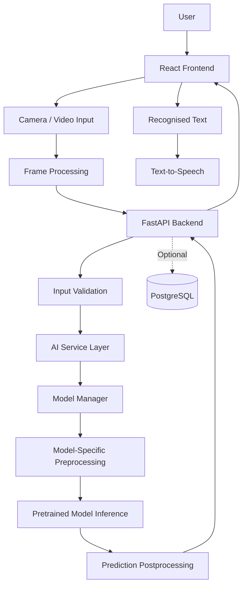

# System Architecture

## Signova AI

**Project:** Signova AI  
**Architecture Style:** Modular, Layered Architecture  
**Frontend:** React + javascript + Vite  
**Backend:** FastAPI + Python  
**AI Framework:** PyTorch  
**Primary Goal:** Indian Sign Language Recognition

---

# 1. Architecture Overview

Signova AI follows a modular architecture that separates the user interface, backend services, AI processing, and data management.

The system is designed to keep AI models independent from the backend API and frontend application.

This allows models to be replaced or improved without rewriting the entire application.

### Main Components

1. Frontend Application
2. Backend API
3. AI Processing Layer
4. Model Management Layer
5. Optional Data Layer

---

# 2. High-Level System Architecture



The exact processing path depends on the selected model.

For example, a pose-based model requires landmark extraction and compatible preprocessing. An image-based model may require a different pipeline.

---

# 3. Frontend Architecture

**Technology:** React, TypeScript, Vite

The frontend handles user interaction and communicates with the backend through HTTP APIs.

### Responsibilities

- Display the application interface.
- Request camera permissions.
- Show live camera preview.
- Capture frames or supported input.
- Send recognition requests.
- Display recognised text.
- Show processing and model status.
- Handle API errors.
- Provide speech controls.

### Suggested Structure

```text
frontend/
└── src/
    ├── assets/
    ├── components/
    │   ├── camera/
    │   ├── recognition/
    │   ├── translation/
    │   ├── speech/
    │   ├── layout/
    │   └── common/
    ├── pages/
    ├── hooks/
    ├── services/
    ├── context/
    ├── types/
    ├── utils/
    ├── styles/
    ├── App.tsx
    └── main.tsx
```

### Frontend Modules

| Module | Responsibility |
|---|---|
| Camera | Camera permission and preview |
| Recognition | Recognition controls and results |
| Translation | Display recognised text |
| Speech | Text-to-speech controls |
| Services | Backend API communication |
| Hooks | Reusable React logic |
| Types | TypeScript interfaces |

The frontend must not contain model weights or backend secrets.

---

# 4. Backend Architecture

**Technology:** FastAPI, Python

The backend acts as the communication layer between the frontend and AI modules.

### Responsibilities

- Expose REST API endpoints.
- Validate incoming requests.
- Coordinate AI inference.
- Manage model availability.
- Format prediction responses.
- Handle errors.
- Provide health information.

### Suggested Structure

```text
backend/
├── app/
│   ├── api/
│   │   └── routes/
│   ├── core/
│   ├── schemas/
│   ├── services/
│   └── main.py
├── tests/
└── requirements.txt
```

### Backend Layers

| Layer | Responsibility |
|---|---|
| API Routes | Receive HTTP requests |
| Schemas | Validate request and response data |
| Services | Coordinate application operations |
| Core | Configuration and shared utilities |
| Main | Initialize FastAPI |

### Request Flow

1. Frontend sends a request.
2. API route receives the request.
3. Schema validates the input.
4. AI service processes the request.
5. Model manager selects the loaded model.
6. AI inference returns a prediction.
7. Backend formats the response.
8. Frontend displays the result.

---

# 5. AI Processing Architecture

The AI layer contains reusable modules responsible for preparing input, running inference, and processing predictions.

### Suggested Structure

```text
ai/
├── preprocessing/
├── pose_extraction/
├── inference/
├── model_adapters/
├── postprocessing/
└── config/
```

### AI Modules

**Preprocessing**

- Input validation.
- Coordinate normalisation.
- Model-specific transformations.
- Sequence preparation.

**Pose Extraction**

- Hand landmark extraction, if required.
- Body landmark extraction, if required.
- Landmark ordering and formatting.

**Model Adapters**

- Model-specific loading.
- Model-specific preprocessing.
- Inference execution.
- Output conversion.

**Inference**

- Execute model predictions.
- Manage inference settings.
- Handle model execution errors.

**Postprocessing**

- Format predictions.
- Validate outputs.
- Handle confidence information when available.

---

# 6. Model Management Architecture

Signova AI uses a modular model management approach.

The model manager is responsible for loading and providing access to the selected pretrained model.

### Responsibilities

- Load model checkpoints.
- Manage model configuration.
- Check model availability.
- Reuse loaded models.
- Handle loading errors.
- Provide model information.

### Initial Experimental Model

`manavdhamecha77/iSign-t5-pose-to-text`

Initial checkpoint: `t5-small`

This candidate accepts structured pose and hand landmark inputs.

It must not be connected directly to raw webcam frames without implementing its required preprocessing pipeline.

### Model Integration Flow

```text
AI Service
    |
    v
Model Manager
    |
    v
Model Adapter
    |
    v
Input Preprocessing
    |
    v
Pretrained Model
    |
    v
Prediction
    |
    v
Postprocessing
```

Model-specific logic must remain inside the AI layer.

---

# 7. Visual Input Processing Pipeline

The visual processing pipeline converts camera or video input into model-compatible data.

### Planned Flow

```text
Camera / Video
      |
      v
Frame Capture
      |
      v
Frame Validation
      |
      v
Feature Extraction
      |
      v
Model-Specific Preprocessing
      |
      v
Model-Compatible Input
```

### Important Design Rule

The preprocessing pipeline must match the selected model's original requirements.

For the iSign T5 candidate, verify:

- Required pose landmarks.
- Left-hand landmark format.
- Right-hand landmark format.
- Landmark ordering.
- Input dimensions.
- Coordinate normalisation.
- Motion features, if using a motion checkpoint.
- Sequence length requirements.

Do not assume that arbitrary MediaPipe output is compatible.

---

# 8. API Communication Architecture

The frontend communicates with FastAPI through REST endpoints.

### Planned Endpoints

| Endpoint | Method | Purpose |
|---|---|---|
| `/api/v1/health` | GET | Backend health |
| `/api/v1/ai/health` | GET | AI service health |
| `/api/v1/ai/models` | GET | Model information |
| `/api/v1/ai/predict/image` | POST | Image prediction, if supported |
| `/api/v1/ai/predict/video` | POST | Video prediction, if supported |
| `/api/v1/ai/predict/landmarks` | POST | Landmark prediction, if supported |

Only implement endpoints supported by the selected model pipeline.

See `API_DOCUMENTATION.md` for request and response specifications.

---

# 9. Data Architecture

PostgreSQL is optional and is not required for the initial MVP.

Future database responsibilities may include:

- User accounts.
- Recognition history.
- User preferences.
- Model metadata.

### Suggested Structure

```text
database/
    |
    v
PostgreSQL
    |
    ├── users
    ├── ai_models
    ├── recognition_history
    └── user_preferences
```

Do not introduce database dependencies until a feature requires persistent storage.

---

# 10. Complete Recognition Workflow

The intended end-to-end workflow is:

1. User opens Signova AI.
2. User grants camera permission.
3. Frontend displays the live camera preview.
4. Frontend captures supported input.
5. Input is sent to the backend.
6. Backend validates the request.
7. AI service selects the appropriate model adapter.
8. Visual data is prepared using model-specific preprocessing.
9. The pretrained model performs inference.
10. Prediction output is processed.
11. Backend returns structured results.
12. Frontend displays recognised text.
13. User can request speech output.

This workflow applies only to input types supported by the selected model.

---

# 11. Error Handling Architecture

The system should handle errors at each layer.

| Layer | Possible Error | Expected Handling |
|---|---|---|
| Frontend | Camera permission denied | Show permission message |
| Frontend | API unavailable | Show connection error |
| Backend | Invalid request | Return validation error |
| Backend | Model unavailable | Return service error |
| AI | Checkpoint missing | Report model loading failure |
| AI | Invalid input shape | Return preprocessing error |
| AI | Inference failure | Return inference error |
| Speech | Unsupported browser voice | Show speech unavailable message |

Internal stack traces and sensitive server details must not be exposed to users.

---

# 12. Deployment Architecture

### Development Environment

```text
Windows Local Machine
       |
       ├── React + Vite
       |      Port: 5173
       |
       ├── FastAPI
       |      Port: 8000
       |
       ├── AI Model
       |      Local CPU / NVIDIA GPU
       |
       └── Local Model Checkpoints
```

### Future Production Environment

```text
User Browser
      |
      v
Frontend Hosting
      |
      v
HTTPS API Request
      |
      v
GPU-Capable Backend
      |
      v
AI Model Inference
      |
      v
Prediction Response
```

The frontend and backend may be deployed separately.

The backend must run on infrastructure capable of supporting the selected model's runtime requirements.

---

# 13. Security and Privacy Architecture

The system should follow these rules:

- Request camera access only when needed.
- Do not record video automatically.
- Avoid unnecessary media storage.
- Validate uploaded files.
- Keep model checkpoints outside Git.
- Store secrets in environment variables.
- Configure trusted CORS origins.
- Use HTTPS in production.
- Avoid exposing backend credentials.
- Handle user data responsibly.

See `SECURITY.md` for the security policy.

---

# 14. Architecture Design Principles

Signova AI follows these principles:

1. **Modularity:** Keep frontend, backend, and AI responsibilities separate.
2. **Reusability:** Use reusable AI modules and services.
3. **Replaceability:** Allow pretrained models to be replaced without rewriting the application.
4. **Testability:** Test each layer independently.
5. **Scalability:** Keep the architecture ready for future model improvements.
6. **Maintainability:** Avoid unnecessary dependencies and duplicated code.
7. **Privacy:** Process only the data required for recognition.
8. **Honest Evaluation:** Do not claim unsupported recognition capabilities.

---

# 15. Current Architecture Scope

The following items describe the intended architecture, not necessarily implemented functionality.

| Component | Planned Status |
|---|---|
| React Frontend | Planned |
| FastAPI Backend | Planned |
| Model Manager | Planned |
| iSign T5 Adapter | Experimental candidate |
| Visual Processing | Model-dependent |
| Prediction API | Planned |
| Text-to-Speech | Planned |
| PostgreSQL | Optional future component |

Update this table as implementation progresses.

---

# 16. Final Architecture Goal

The goal is to build a modular Signova AI application where:

- The frontend manages camera input and user interaction.
- The backend manages requests and application services.
- The AI layer manages preprocessing and model inference.
- The model manager supports replaceable pretrained models.
- The output layer provides recognised text and speech.

This architecture provides a foundation for expanding from supported sign recognition towards dynamic and continuous Indian Sign Language understanding.