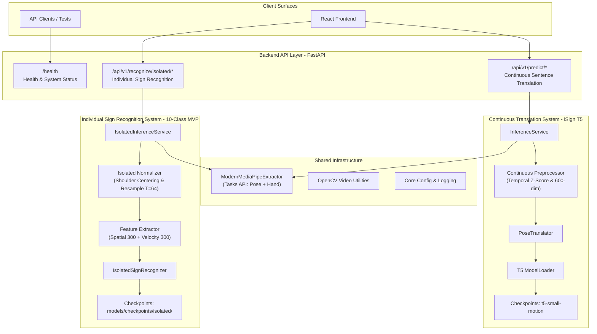

# F-019.1: Signova AI ML Architecture Separation Report

**Date:** 2026-11-12  
**Repository:** `D:\Signova AI`  
**Status:** Completed & Verified  
**Scope:** Decouple Individual ISL Sign Recognition from Continuous ISL Sentence Translation  

---

## 1. Executive Summary

This architecture separation establishes a clean, decoupled foundation for two coexisting Machine Learning recognition systems within the single Signova AI repository:

1. **Individual ISL Sign Recognition:** New 10-class isolated sign recognition system (F-018 – F-021), architected to scale to 30–40 signs.
2. **Continuous ISL Sentence Translation:** Existing production iSign T5 pose-to-text sequence-to-sequence translation pipeline.

Both systems operate independently without cross-system breaking changes, shared mutable state, or conflicting normalization pipelines. All existing iSign T5 functionality, checkpoints, preprocessing routines, and backend endpoints remain 100% intact and operational.

---

## 2. Existing vs. Proposed Architecture



---

## 3. Identified Conflicts and Architectural Solutions

| Domain | Continuous Translation (iSign T5) | Individual Sign Recognition (10-Class MVP) | Resolution / Boundary |
|---|---|---|---|
| **MediaPipe Pipeline** | Modern Tasks API (PoseLandmarker + HandLandmarker) in VIDEO mode. | Same underlying 75-landmark extractor. | **Shared Engine:** Both use `ModernMediaPipeExtractor` to generate 75 landmarks $\times$ 4 channels (`[x, y, z, conf]`). Avoids duplicate model instantiations. |
| **Coordinate Normalization** | Whole-sequence temporal z-score normalization: $(x - \mu) / \sigma$. | Spatial normalization centered on mid-shoulder, scaled by shoulder width. | **Strict Isolation:** Continuous z-score amplifies sensor jitter on short isolated clips. Spatial centering lives in `ai/isolated/preprocessing/normalizer.py`. |
| **Temporal Resampling** | Variable sequence padding / truncation (up to $T=256$ frames). | Fixed uniform interpolation resampling ($T=64$ frames). | **Separate Resampling:** Linear temporal interpolation in `ai/isolated/preprocessing/normalizer.py`. |
| **Feature Dimensionality** | (T, 300) spatial coordinates or (T, 600) with temporal velocity. | (64, 600) resampled spatial + velocity representation. | Formats are mathematically distinct and encapsulated within their respective loaders. |
| **Serialization Format** | Official `.pose` binary format (`pose_format` library). | Compressed `.npz` files with explicit `landmarks`, `timestamps`, and `detection_mask`. | Isolated pipeline has zero runtime dependency on the `pose_format` C++ library. |
| **Model Architecture** | Autoregressive T5 Transformer Encoder-Decoder (PyTorch). | Multi-class Classifier (BiLSTM, XGBoost, Random Forest, or H2O AutoML). | Independent loaders and checkpoint paths. |
| **Memory Footprint** | ~250 MB (t5-small-motion) / ~890 MB (t5-base-motion). | < 50 MB RAM for isolated classifier. | Both models comfortably coexist simultaneously in memory (< 1 GB total). |
| **API Endpoints** | `POST /api/v1/predict/video`<br/>`POST /api/v1/predict/landmarks` | `POST /api/v1/recognize/isolated/video`<br/>`POST /api/v1/recognize/isolated/landmarks` | Prefix-separated modular routing under FastAPI. |

---

## 4. Module Separation Breakdown

### 4.1 Individual Sign Recognition (`ai/isolated/`)
Created independent, modular package structure:
```text
ai/isolated/
├── __init__.py                  # Root package exports
├── config/
│   ├── __init__.py
│   └── isolated_settings.py     # 10-class labels, dimensions (75x4, T=64), paths
├── preprocessing/
│   ├── __init__.py
│   └── normalizer.py            # Spatial shoulder centering and temporal resampling (T=64)
├── features/
│   ├── __init__.py
│   └── feature_extractor.py     # First-order velocity deltas and 600-dim concatenation
├── training/
│   ├── __init__.py
│   └── dataset_loader.py        # Streamlined stdlib CSV and .npz split loader
├── evaluation/
│   ├── __init__.py
│   └── metrics.py               # Macro F1, top-3 accuracy, per-class report, confusion matrix
└── inference/
    ├── __init__.py
    └── classifier.py            # IsolatedSignRecognizer inference engine with top-k output
```

### 4.2 Continuous Sign Translation (`ai/continuous/`)
Preserved all existing continuous translation files without modification:
```text
ai/
├── continuous/                  # Re-export namespace mapping to existing continuous modules
│   └── __init__.py
├── inference/
│   ├── model.py                 # T5 Transformer model definition
│   ├── model_loader.py          # iSign T5 checkpoint loader
│   └── pose_translator.py       # Continuous PoseTranslator
├── pose_extraction/
│   ├── mediapipe_extractor.py   # Shared ModernMediaPipeExtractor
│   └── pose_generator.py        # Video-to-.pose generator
└── preprocessing/
    └── pose_preprocessor.py     # Continuous iSign z-score and velocity preprocessing
```

### 4.3 Checkpoint and Storage Layout
- Continuous Checkpoints: `models/checkpoints/` (`t5-small-motion`, `t5-base-motion`).
- Isolated Checkpoints: `models/checkpoints/isolated/` (dedicated directory for isolated models).
- Isolated Labels: `models/labels/isolated_labels.json` (`["food", "hello", "help", "no", "please", "sorry", "stop", "thank you", "water", "yes"]`).

---

## 5. Backend API Separation

FastAPI router separation is registered via `backend/app/api/router.py`:

```python
from fastapi import APIRouter
from app.api.routes import health, isolated_recognition, predict

api_router = APIRouter()
api_router.include_router(health.router)
api_router.include_router(predict.router)
api_router.include_router(isolated_recognition.router)
```

### Endpoint Inventory
1. **Health & System Monitoring:**
   - `GET /health` and `GET /api/v1/health`
2. **Continuous Translation (iSign T5):**
   - `POST /api/v1/predict/video` — Accepts video or `.pose` file, outputs translated sentence.
   - `POST /api/v1/predict/landmarks` — Accepts sequence of 300-dim frames, outputs translated sentence.
3. **Individual Sign Recognition:**
   - `POST /api/v1/recognize/isolated/video` — Accepts isolated sign video, outputs top-k predicted signs with confidence.
   - `POST /api/v1/recognize/isolated/landmarks` — Accepts (T, 300) landmark sequence, outputs top-k predicted signs.

---

## 6. Verification and Test Results

Automated test execution across both continuous and isolated pipelines confirms zero regressions:

| Test Suite | Tests | Status | Execution Time | Coverage / Scope |
|---|---|---|---|---|
| `backend/tests/test_health.py` | 5 | **PASSED** | 0.67s | Health checks, OpenAPI metadata, dependency isolation. |
| `tests/test_pose_preprocessing.py` | 12 | **PASSED** | 9.22s | Continuous iSign T5 pose normalization, z-score, velocity. |
| `tests/test_isolated_recognition_pipeline.py` | 7 | **PASSED** | 2.70s | Isolated temporal resampling, spatial centering, features, recognizer, and metrics. |
| **Total** | **24** | **PASSED (100%)** | **12.59s** | **Both systems verified green** |

---

## 7. Readiness for F-020 and F-021

- **Module Independence:** Confirmed. Isolated sign recognition can be trained, evaluated, and deployed without touching any iSign T5 code.
- **Data Readiness:** `datasets/landmarks/{train,validation,test}/` (187 clips, 21,357 frames) can be loaded directly via `ai.isolated.training.dataset_loader.load_split_dataset`.
- **Backend Readiness:** `isolated_inference_service` is hooked up to the FastAPI router and ready to serve model predictions once classifier weights are saved to `models/checkpoints/isolated/isolated_10class_best.joblib`.
